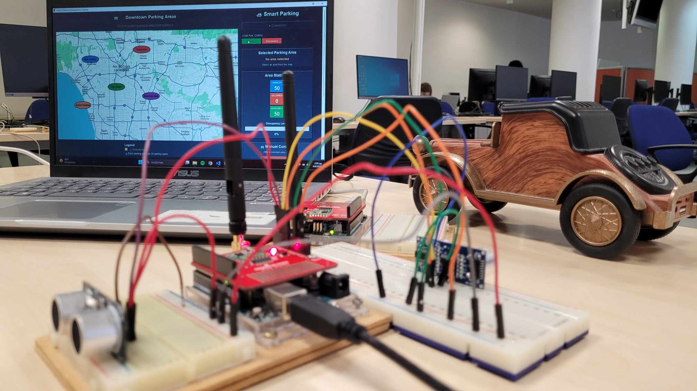
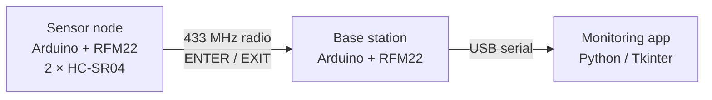
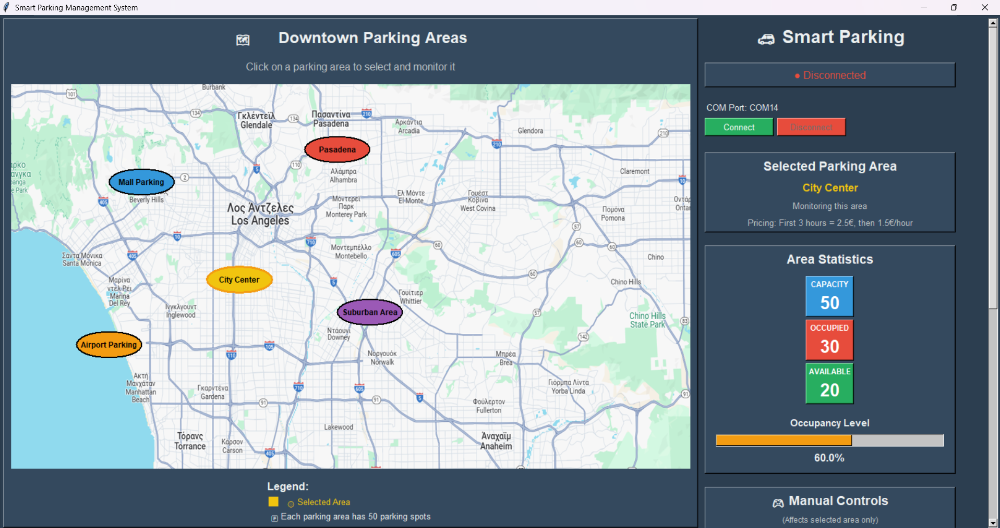

# Smart Parking with a Wireless Sensor Network

A small wireless sensor network that counts the cars entering and leaving a parking lot and shows its live occupancy on a map.
Team project for the **Applications of Telecommunication Devices** course at ECE AUTH during the 2024–2025 academic year.



## How it works



- **Sensor node:** two ultrasonic sensors watch the entrance and the exit every 0.5 s. When an object comes closer than 10 cm, and the previous reading was farther away, the node sends `ENTER` or `EXIT`. Checking the previous reading means a car that stops at the gate is counted only once.
- **Base station:** receives each message, sends an acknowledgement and prints the event on the serial port.
- **Monitoring app:** shows five parking areas of 50 spots each on a map. For the selected area it updates the occupied and free spots, shows the pricing and an occupancy bar, warns when the lot is full and keeps an activity log. Manual buttons let you correct the count or test without the hardware.

The radios use the RF22Router library at 433 MHz with OOK modulation (40 kbps) and 20 dBm output power.



## Network capacity

Assuming 100-bit packets sent about once per second at 100 kbps, each node keeps the channel busy for 1 ms per second ($S = 0.001$). With pure ALOHA ($S_{max} = 0.186$), one base station could serve up to **186 sensor nodes**.

## Repository structure

```
firmware/
  transmitter/   sensor node sketch
  receiver/      base station sketch
gui/             monitoring app and map image
libraries/       Arduino libraries (RF22, Ultrasonic)
docs/            report, presentation and photos
```

## Running it

1. Install the two libraries from `libraries/` in the Arduino IDE (*Sketch → Include Library → Add .ZIP Library*).
2. Upload `firmware/transmitter` to the board with the sensors (trigger/echo on A0/A1 for the entrance, A2/A3 for the exit) and `firmware/receiver` to the second board.
3. Connect the receiver by USB, set `COM_PORT` at the top of `gui/parking_gui.py`, then run:

   ```bash
   pip install -r gui/requirements.txt
   python gui/parking_gui.py
   ```

4. Click a parking area on the map, then press **Connect**.

## Demo

- [Demo video](https://www.youtube.com/watch?v=2M6oESmxwL0)
- [Promo video](https://www.youtube.com/watch?v=g7QFT5BLIXE)

The full write-up is in the [report](docs/report.pdf) and the [presentation](docs/presentation.pptx).
